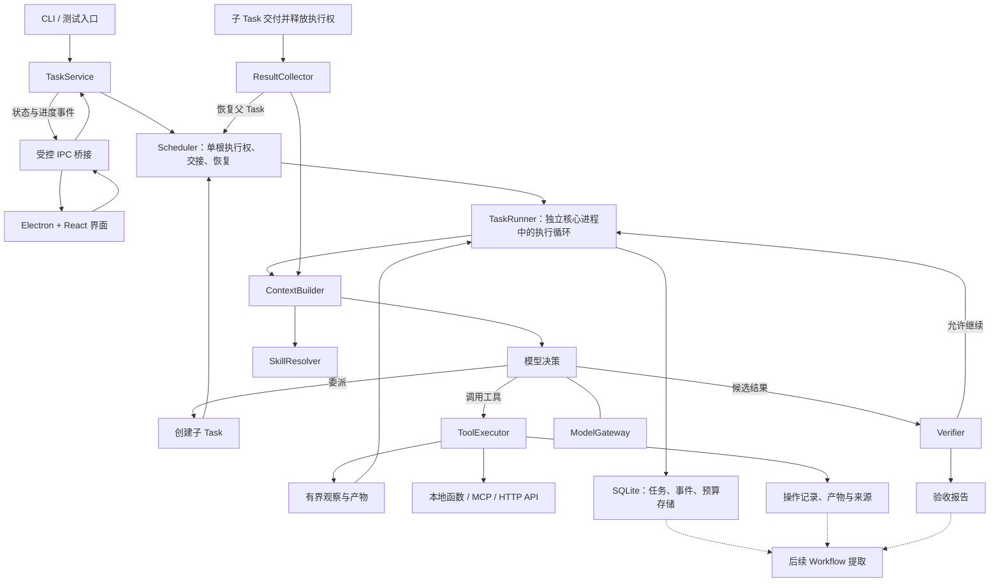
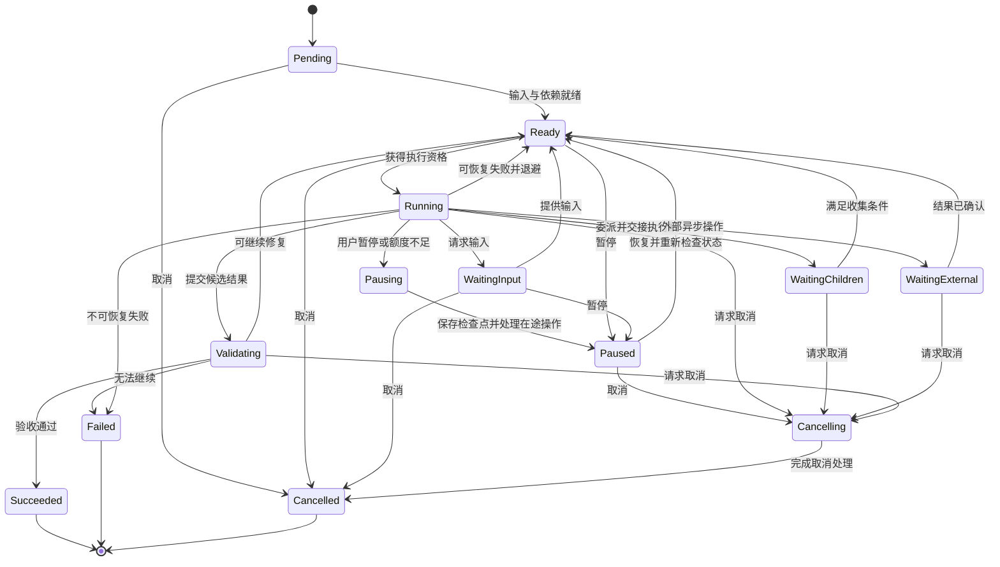
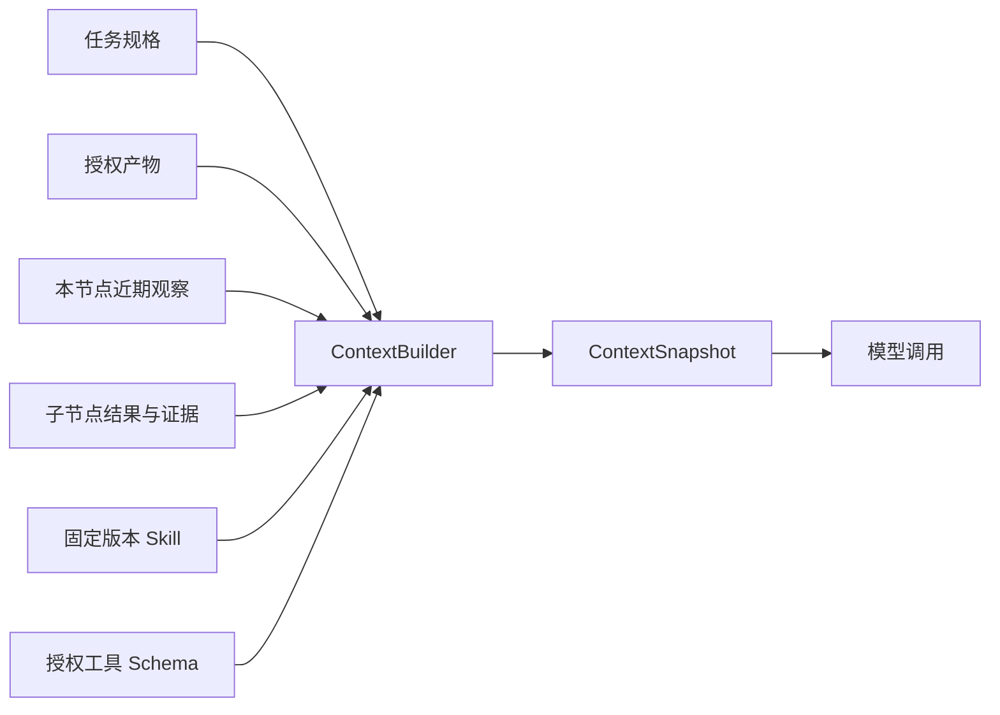

# Traceleaf 体系架构基线

- 基线日期：2026-10-17
- 状态：桌面优先的开发设计基线，尚未实现
- 适用范围：递归任务运行时地基，以及未来 Workflow 提取所需的数据与执行契约

本文固化项目定位、模块职责和执行约束，作为实现与评审依据。范围和推进阶段见 [项目计划书](project-plan.md)，依赖选型见 [技术选型](tech-stack.md)。数据结构表示概念契约，具体字段与数据库迁移由实施阶段补充。修改核心语义时，应同步修改本文及相关验收标准。

## 1. 项目定位

Traceleaf 将复杂目标展开成递归任务树。每个节点研究一个具有明确目标和验收边界的任务，可以调用工具、请求输入、继续委派子任务，最终向父节点交接结果与证据。

“单一任务”可以包含多次模型与工具调用；它不意味着数据库事务意义上的原子操作。同一根任务树仅允许一个节点持有活跃执行权，父任务挂起后子任务才开始。单次 Loop 受到步数、费用、时间与无进展策略约束；整体任务不默认以固定深度或节点数量终止。用户可设置整体费用上限和截止时间，额度不足时保存进度并暂停续跑。

长期链路为：

```text
复杂目标
  → 隔离上下文的递归探索
  → 产物与验收证据
  → 轨迹裁剪、依赖分析、参数化
  → 候选 Workflow
  → 新输入与故障验证
  → 版本化 Workflow
  → 业务产品消费
```

### 1.1 与其他项目的关系

| 组件 | 目标职责 | 当前关系 |
| --- | --- | --- |
| Traceleaf | 递归任务运行、探索记录与 Workflow 提取 | 本仓库待实现 |
| Storyloom | 提供业务输入、人工确认、结果展示，消费 Workflow | 当前独立，后续集成 |
| 世界状态引擎 | 提供叙事事实、事件、时间、分支与证据检索 | 后续能力模块 |
| comfyui-maker | 资源、模型与 Workflow 查询及引用交接 | 后续通过明确接口集成 |
| ComfyUI 执行工具 | 提交和查询生成任务 | 后续能力适配 |
| blender-vse | 时间线编辑、版本冲突处理与持久化验证 | 后续 MCP 适配 |

Workflow 执行层可以复用 Traceleaf 内核，也可以采用独立运行器。该选择尚未定案，但导出契约应支持离开原探索会话运行。Skill 是节点加载的指令资源；实际动作由工具执行。

## 2. 架构原则

1. 所有递归层级使用统一 Task 抽象，父节点通过契约消费子节点结果。
2. 节点上下文独立，输入、产物与能力通过显式绑定交接。
3. 隔离控制信息传播范围，不能保证摘要、工具输出或推断天然正确。
4. 模型提出决策，运行时负责授权、状态变更与真实执行。
5. 调度、决策、外部执行、验收与持久化分别承担明确职责。
6. SQLite 中的业务状态为执行事实源，界面和可选通知通道不持有另一份独立运行状态。
7. 外部副作用允许出现结果未知状态，不假设端到端恰好执行一次。
8. 从第一天记录实际输入输出依赖、资源修改与验收证据。
9. 单条成功轨迹仅能产生候选 Workflow，复用能力需要新输入验证。
10. 验收不以模型声称完成或工具返回成功作为充分条件。
11. 同根任务树串行交接执行权，不自动识别或安排并行机会。
12. Jev/Laya 是可替换的辅助评审后端，不是预算单位。

## 3. 系统结构



### 3.1 模块职责

| 模块 | 职责 |
| --- | --- |
| TaskService | 创建、查询、暂停、取消、补充输入与恢复任务，校验入口契约 |
| Scheduler | 管理根任务执行权、父子串行交接、退避与恢复 |
| TaskRunner | 推进状态机，协调一次决策、执行、等待与验收 |
| ContextBuilder | 按授权输入与上下文预算组装模型输入 |
| ModelGateway | 适配模型协议，归一决策、响应与用量 |
| SkillResolver | 按需解析 Skill，固定版本与内容摘要 |
| ToolRegistry | 发现工具、管理 Schema 与能力描述 |
| ToolExecutor | 参数、权限、预算、幂等、超时与外部执行 |
| ResultCollector | 接收当前委派子任务的结果，幂等恢复父任务 |
| Verifier | 程序校验与可选 Jev/Laya 辅助评审，生成有证据的判定 |
| CapabilityBinder | 解析 Skill/Tool 版本、依赖和授权，创建任务时绑定能力 |
| ExecutionEnvironment | 提供进程或容器、凭证和实际资源访问边界 |
| Persistence | 保存任务状态、操作、事件、预算和产物元数据 |
| ArtifactStore | 保存与读取大体积内容及不可变产物版本 |

内核不直接依赖供应商响应格式、MCP 传输细节或 Electron 窗口对象。CLI 与桌面复用核心；网页接入时可增加 HTTP 适配层。界面不直接访问数据库、凭证或执行任意工具。

## 4. 领域契约与身份

| 契约 | 关键内容 | 语义 |
| --- | --- | --- |
| TaskSpec | 目标、输入、验收、输出 Schema、能力要求、运行限制 | 描述任务要求 |
| TaskRun | 任务 ID、父节点、规格引用、状态、修订号 | 树中的一个逻辑任务节点 |
| TaskAttempt | 尝试 ID、执行者、租约、起止时间、错误 | 节点的一次执行尝试 |
| TaskResult | 摘要、输出引用、证据、未解决项、用量引用 | 父子交接协议 |
| Decision | 工具调用、委派、完成候选结果、请求输入 | 模型与运行时的决策协议 |
| CapabilityBinding | 工具与 Skill 的身份、版本、范围与配置 | 节点实际获得的能力 |
| ArtifactRef | 产物 ID、版本、哈希、类型、位置 | 指向可验证内容 |
| OperationRecord | 操作 ID、输入、外部关联、状态、结果 | 跟踪外部动作与副作用 |
| BudgetAllocation | 父配额、额度、预留、结算、未确认项 | 分层控制消耗 |
| ExecutionEvent | 事件 ID、节点内序号、关联 ID、类型、载荷 | 解释执行过程 |
| ValidationReport | 检查项、证据、判定方式、结果 | 解释完成依据 |

```text
task_id          一个逻辑任务节点
attempt_id       节点的一次执行尝试
decision_id      一次模型决策
operation_id     一次具体外部操作
artifact_id      一个产物身份
artifact_version 产物的不可变版本
```

Worker 重启后可以创建新 attempt，但恢复同一外部操作时必须核对原 operation，不能仅生成新 ID 再次执行。

### 4.1 TaskSpec

```text
TaskSpec
├── goal
├── inputs[]
├── acceptance_criteria[]
├── output_schema
├── capability_requirements[]
├── constraints
│   ├── loop_deadline
│   ├── max_steps
│   └── loop_cost_limit
└── budget_allocation_id
```

每项验收条件应标明检查方式、必需证据与通过规则。结构校验、确定性检查、模型辅助判定和人工确认分别记录；模型判定不应隐去其不确定性。

能力要求需由运行时解析授权。子节点获得的权限不得超过父节点可委派范围，不能由模型请求自动扩大。

## 5. 节点状态机



该图表示主要迁移。实现时应使用统一迁移函数检查合法性、修订号和终态约束。根任务暂停还需阻止后续调度，并保留原等待条件供恢复时重新判断。截止时间与预算策略覆盖所有适用状态，暂停和终止原因单独记录，不靠异常字符串推断。

### 5.1 初版递归语义

- 模型使用类型化 delegate 决策提出子任务，由运行时校验、分配预算并创建。
- 父节点委派后保存状态，释放执行资源，进入 WaitingChildren。
- 初版一次委派一个子任务。子任务交付并释放执行权后，父任务恢复审查，再决定是否委派下一个子任务。
- 子任务成功不代表父目标成功，父节点必须汇总并完成自身验收。
- 部分失败由父节点依据错误类别和剩余约束决定重试、重规划或失败。
- 默认取消向尚未结束的后代传播，外部无法取消或结果未知的操作继续保留核对记录。
- 同一个完成通知可能重复到达，收集与唤醒必须幂等。
- 同根任务树禁止父子或兄弟同时推进。根执行权与节点修订检查在重复领取、恢复时仍然有效。根任务暂停时，祖先保留等待状态并阻止链上继续调度；恢复先检查等待原因和未确认操作，不能直接唤醒全部祖先。

### 5.2 错误与停止策略

至少区分临时故障、输入缺失、权限拒绝、资源版本冲突、操作结果未知、验收失败、无进展、步数耗尽、预算耗尽、截止时间和取消。

步数耗尽不能自动等价于任务过大。只有判断拆解能够推进目标且当前授权、用户费用政策允许时才继续委派；额度不足可暂停续跑。相同目标与输入的重复委派、重复工具行动和无效修复应纳入无进展检测。

## 6. 上下文与能力隔离



| 来源 | 加载规则 |
| --- | --- |
| 父节点历史 | 不自动继承，仅传明确选定的输入 |
| 兄弟节点历史 | 不自动共享，通过授权产物引用交接 |
| 子节点探索记录 | 默认提供结果摘要与证据，必要时再定向读取 |
| Skill | 先发现描述，再按需加载正文，记录版本和内容哈希 |
| 工具定义 | 按任务需求挂载，并受实际授权范围约束 |
| 大型工具结果 | 外置为产物，以摘要、分页与读取入口呈现 |
| 本节点历史 | 在 Token 预算内保留关键事实、错误和未解决项 |

ContextSnapshot 应可解释实际发给模型的内容：提示模板、模型配置、工具 Schema、Skill 版本、产物版本、摘要与截断信息。敏感请求数据按保存策略处理，密钥不得写入快照和日志；引用内容需有对应保留策略。

### 6.1 上下文持久化职责

SQLite 分别保存任务规格、能力绑定、执行历史、工作检查点和上下文快照；大体积内容保存在 ArtifactStore。ContextBuilder 按目标、稳定指令、显式输入、工作状态、近期历史、按需资料和当前工具定义组织本轮输入。

任务状态不依赖网页消息数组。检查点中的模型摘要保留来源与不确定性，不能覆盖操作表中的实际执行状态。普通轮次尽量稳定追加；达到上下文阈值或工作阶段变化时在检查点重建，不要求每轮总结。用户补充要求先记录为持久指令，在相应节点的下一次决策前生效；目标变化另行记录版本并判断当前子任务是否仍适用。

### 6.2 四种边界

1. 上下文隔离：模型可以看到什么信息。
2. 能力授权：运行时允许节点执行什么操作。
3. 资源权限：操作可访问哪些文件、项目和服务。
4. 执行隔离：代码在哪个进程、容器或沙箱运行。

隐藏工具 Schema 不构成权限控制。独立消息历史不构成文件系统或进程隔离。Skill、检索材料与工具结果也不能自行授予权限。

执行状态库保存任务推进情况；未来世界状态库保存叙事事实。世界状态引擎通过普通能力接口接入，作品分支与任务树节点分别建模。

## 7. 模型与工具执行

### 7.1 ModelGateway

```text
decide(context, capability_bindings, limits)
    → decision + usage + provider_metadata
```

负责结构化输出和工具调用两种模式，将供应商结果归一成 Decision，校验 Schema，区分拒绝、截断与无效输出，并处理超时、限流、退避和用量记录。

ModelGateway 不直接创建业务任务或执行工具。请求超时可能已产生费用，重试记录需保留供应商请求关联与未确认用量。

### 7.2 工具描述

```text
ToolDescriptor
├── name / version
├── input_schema / output_schema
├── resource_scope
├── effect：read / write / external_job
├── retry_policy
├── idempotency_support
├── timeout
└── approval_requirement
```

### 7.3 操作执行协议

```text
校验输入与权限
  → 预留预算
  → 持久化操作意图
  → 调用外部能力
  → 保存结果与产物引用
  → 结算用量
  → 返回有界观察
```

操作状态至少区分 planned、in_flight、succeeded、failed 和 unknown。外部任务还需保存供应商任务 ID、查询方式、截止时间和取消能力。

若外部操作成功、Worker 在保存结果前退出：

- 支持幂等的工具使用相同操作标识查询或重试；
- 支持状态查询的工具核对实际结果；
- 两者都不支持时进入待核对状态，避免盲目重复写入。

### 7.4 执行权与外部状态保护

| 机制 | 解决的问题 |
| --- | --- |
| Worker 租约 | 当前谁有资格推进任务 |
| Task 修订号 | 过期执行者能否提交内部状态 |
| 操作幂等标识 | 同一外部操作是否重复生效 |
| 外部资源版本号 | 是否覆盖他人的新修改 |
| 预算事务 | 是否重复分配或重复记账 |

租约过期不能自动撤销已发出的外部请求。内部提交需防止过期执行者覆盖状态；外部写操作仍依赖资源端的版本、幂等或实际状态核对能力。

## 8. 持久化与一致性

### 8.1 概念数据关系

```text
task_specs
  └─ task_runs
       ├─ task_attempts
       ├─ task_dependencies
       ├─ context_snapshots
       ├─ decisions
       ├─ operations
       │    └─ operation_artifacts
       ├─ validation_reports
       └─ execution_events

artifacts
  └─ artifact_versions
       └─ artifact_lineage

budget_allocations
  ├─ child_allocations
  ├─ reservations
  └─ ledger_entries
```

### 8.2 存储职责

| 组件 | 用途 |
| --- | --- |
| SQLite | 本地任务状态、操作、事件、预算、检查点与产物元数据 |
| 本地 ArtifactStore | 大型工具结果、文件产物、需保留的模型响应 |
| 后续对象存储适配器 | 承载远端与规模化产物存储 |
| 可选后续远程存储或派送服务 | 需求明确后设计，不属于本地首版前提 |

初版由独立核心运行进程推进本地任务，以 SQLite 检查点恢复。进程内事件可用于唤醒，持久状态决定是否可执行；启动时扫描待恢复节点，不依赖易失事件保证正确性。SQLite 访问集中管理，事务不跨越模型、网络或外部工具调用。界面关闭、应用退出与操作系统后台服务采用不同生命周期，首版不承诺退出后持续执行。

### 8.3 一致性要求

- 状态迁移与对应关键事件在同一事务提交。
- 子任务创建、预算分配和父节点等待关系原子提交。
- 通过修订号或条件更新防止并发覆盖。
- 子任务完成通知重复到达不得重复汇总或重复结算。
- 文件写入与数据库事务不具备天然原子性：先写入并校验不可变内容，再登记元数据；失败遗留文件需可核对和清理。
- 初版采用当前状态表加持久化执行事件，不承诺完整事件溯源或任意历史重演。

## 9. 分层预算账本

```text
根任务额度
  ├─ 本节点操作预留
  ├─ 子任务 A 配额
  └─ 子任务 B 配额
```

预算分别记录 Token、货币成本、运行时间与工具次数。Jev/Laya 评审调用的实际费用也计入账本。单次 Loop 设置执行限制；根任务累计用量，并尊重用户配置的整体上限，达到上限时保存进度并暂停。子任务额度是可选的运行政策，不以固定递归深度或节点数限制整体任务规模。

约束如下：

- 额度分配通过原子事务完成，已分给子节点的额度不能再次分配；重复派送也不能重复预留。
- 每笔消耗有唯一记账归属，祖先仅汇总，不再次扣费。
- 预留、结算和释放具有稳定标识与幂等约束。
- 取消与失败仅释放已确认未消耗部分。
- 用量未知时保留未结算预留，支持后续对账。
- 外部调用成本无法预知或服务不支持硬上限时，应明确预算控制的误差与在途风险，不声称绝对零超支。
- 运行时在调用和委派前检查约束，不能只在调用结束后扣费。

## 10. Workflow 提取所需基础

地基阶段优先保证轨迹与依赖记录完整。提取器后续消费这些记录，生成候选 Workflow。

| 必须记录的信息 | 用途 |
| --- | --- |
| 消费的产物及版本 | 提取数据依赖 |
| 产生的产物及版本 | 从最终结果反向追溯 |
| 工具与 Skill 版本 | 固定能力依赖 |
| 修改的资源与效果 | 判断副作用、重排与并行安全性 |
| 操作前置条件与触发原因 | 提取控制依赖和异常路径 |
| 验收报告与证据 | 保留正确性检查 |
| 输入绑定来源 | 支持参数化 |
| 失败尝试提供的约束 | 避免错误裁剪恢复知识 |

任务树描述委派，产物依赖图描述消费关系。跨节点依赖需显式声明、检查环并避免等待死锁；不能靠隐式读取兄弟节点状态建立依赖。

提取链路：

```text
探索记录
 → 规范化任务、尝试和操作
 → 按最终产物反向追溯
 → 提取数据、控制和资源依赖
 → 参数化输入与能力绑定
 → Workflow IR
 → 静态检查
 → 新输入与故障验证
 → 版本化发布
```

```text
WorkflowSpec
├── input_schema / output_schema
├── nodes
│   ├── kind：tool / agent / condition / approval / subworkflow
│   ├── input_bindings / output_bindings
│   ├── capability_requirements
│   ├── skill_refs
│   ├── preconditions / postconditions
│   └── timeout / retry / budget
├── edges
└── version / provenance / evaluation_record
```

单次轨迹未覆盖的分支不能自动推导为通用规则。Workflow 可以保留 Agent 与人工节点；原始输入上的重放不等价于新输入复用成功。

## 11. 可观测性与验证

事件与日志应关联 task_id、attempt_id、decision_id、operation_id、artifact_id；外部请求和异步任务保留各自关联 ID。可观测性 Span 不替代业务任务树与产物依赖记录。

基础验证覆盖：

- 契约、合法状态迁移与终态约束；
- 父子上下文隔离与能力委派限制；
- Worker 退出、租约过期和过期执行者提交；
- 外部执行成功但结果未落库；
- 重复通知、重复结算、重复预留与同根双活跃保护；
- 部分子任务失败、取消与截止时间；
- 产物完整性和输出验收；
- 相同模型、工具与预算条件下的基线对照。

固定模型配置、能力版本和输入能改善实验可复现性，不保证模型输出逐字一致。比较成功率时应采用独立输入、重复运行并报告波动。

## 12. 技术选择与后续边界

当前选型为 Electron + React、TypeScript Core、SQLite 与本地 ArtifactStore。详细库、驱动待决项、桌面进程边界及可选云端方案统一维护在 [技术选型](tech-stack.md)，本文不重复维护依赖清单。

按模块顺序构筑：ModelGateway → 能力注册与装配 → 单 Task Loop → 任务调度 → 持久化恢复 → 结果验证 → 预算 → 拆解与进展 → 上下文与产物 → 执行环境 → 可观测评测 → 用户控制。其后再做 Electron、真实业务基准、Workflow、World Engine / RAG 与 Storyloom 集成。CLI 按模块提供验证入口，不将完整 Task 系统作为网关前提。重计算由实际工具执行，TS Workflow 执行器负责参数绑定、调用、验证与恢复。World Engine / RAG 和 Storyloom 集成后置。

首个完整里程碑与实施验收见 [地基实施清单](foundation-plan.md)。

完整范围、推进阶段、风险与退出标准见 [项目计划书](project-plan.md)。
